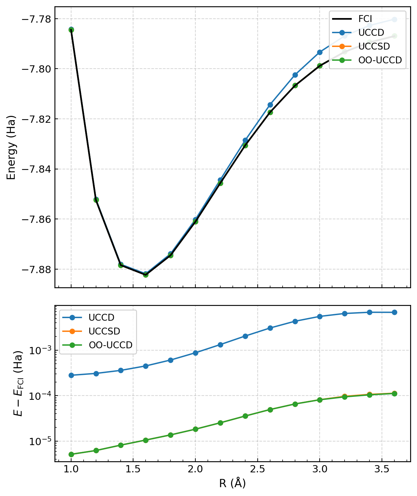

# oouccd-rs

Rust implementation of **sequential orbital optimization for variational
quantum eigensolvers**, accompanying *Sequential optimization for
orbital-optimized variational quantum eigensolvers* by Hiromichi Hayashi and
Takeshi Sato ([arXiv:2610.16032](https://arxiv.org/abs/2610.16032)).
The included [manuscript source](docs/main_rev3.tex) is based on arXiv v1,
with the excitation-gate order description corrected to match the code.
See [manuscript version and license](docs/manuscript-license.md).

The code combines PySCF molecular integrals, a roqoqo/QuEST circuit simulator,
reduced density matrices (RDMs), and classical orbital rotations. Sequential
optimization reconstructs the finite Fourier profile of each parameter and
minimizes it with Aberth polynomial roots and sampled-angle candidates.

## Methods and scope

| Label | Amplitude optimization | Orbital optimization |
|---|---|---|
| `UCCD(seq)` | Sequential UCCD sweeps | Fixed RHF orbitals |
| `UCCSD(seq)` | Sequential UCCSD sweeps | Fixed RHF orbitals |
| `OO(seq)-UCCD(seq)` | Sequential UCCD sweeps | One sequential Givens sweep per macro iteration |
| `OO(lbfgs)-UCCD(seq)` | Sequential UCCD sweeps | L-BFGS with finite-difference orbital gradients |

An OO macro iteration first updates orbitals using a **fixed RDM**, then sweeps
the circuit amplitudes. All trial orbital energies are classical contractions;
OO requires no further circuit measurements after obtaining that RDM. This
coordinate procedure does not guarantee a global optimum over all parameters.

The paper protocol uses exact statevector calculations for LiH/STO-3G, four
electrons and six spatial orbitals, without a frozen core. A finite-shot mode
also exists, using independent Pauli measurements and binomial sampling; the
paper reproduction below uses **no sampling or hardware noise**. Newton OO,
RDM mitigation and uncertainty-aware OO development are on the separate
`newton-shot-noise` branch.

The manuscript's LiH potential-energy curve is shown below. Inspectable rerun
tables and the scope of numerical agreement are linked in the reproduction
section.



## Install and build

Tested on Linux with Python 3.12.3, Rust 1.99.1, NumPy 1.26.4, SciPy 1.13.1,
and PySCF 2.7.0. A Rust toolchain, C/C++ compiler, CMake, `pkg-config`, OpenSSL
development libraries, and a linkable Python installation are required.
Other environments may work but have not been verified here.

From a clone of this repository:

```bash
python3.12 -m venv .venv
.venv/bin/python -m pip install -r requirements.txt
source scripts/python_env.sh
cargo build --release --locked
```

`python_env.sh` selects the same interpreter for PyO3 and Python packages,
sets numerical-library thread limits, and provides a local linker-name symlink
when a Linux cluster has the Python runtime library but lacks that symlink.
To use an existing environment, pass its interpreter explicitly:

```bash
source scripts/python_env.sh /absolute/path/to/venv/bin/python
```

On clusters that prohibit compilation on login nodes, install dependencies in
an appropriate allocation, then use the supplied
[build job](scripts/build_paper.sbatch). The reproduction guide gives the full
Slurm workflow and partition overrides.

## Run a small calculation

```bash
source scripts/python_env.sh
mkdir -p local_runs
unset GCS_PATH BATCH_TASK_INDEX DB_FILEPATH
target/release/oouccd-rs \
  --config-filepath examples/config_h2_manual.json \
  --db-filepath local_runs/h2.db
```

This runs H₂/STO-3G with sequential UCCSD optimization. Use a **fresh database
path for each calculation**: an existing database appends histories rather than
resuming the optimizer. A completed run may have reached its iteration cap;
inspect the convergence flag as well as its completion flag.

See [configuration and result format](docs/configuration.md) for a complete
input example, units, solver options, and the SQLite tables. The
[Rust API example](examples/check_rust_app.rs) constructs the same task without
CLI parsing; run it with `cargo run --release --locked --example check_rust_app`.
Its optional `--render-circuit` flag enables roqollage circuit rendering.

## Reproduce the LiH calculations

The tracked [scan template](examples/lih_paper_scan.json) defines four methods
at fourteen distances from 1.0 to 3.6 Å. All runs start from zero amplitudes,
use a `1e-8` Ha consecutive-energy tolerance, and allow 100 macro iterations.
The Slurm preparer creates isolated inputs, a copied executable, source and
environment records, a job array, and an analysis job. No cloud account or
private input directory is required.

```bash
"$PYO3_PYTHON" scripts/prepare_paper_slurm.py local_runs/lih-smoke \
  --scope smoke --python "$PYO3_PYTHON" --partition defq
job_id=$(sbatch --parsable local_runs/lih-smoke/run.sbatch)
sbatch --dependency="afterok:$job_id" local_runs/lih-smoke/analyze.sbatch
```

The smoke array covers the four methods at 1.6 Å. Use `--scope full` with a new
workspace for all 56 calculations. Replace `defq` with your CPU partition.
Read [the reproduction guide](docs/reproducing_paper_results.md) before a full
run, including its checks and archived-data limitations.

**Verification already performed:** a 56-calculation Slurm rerun completed.
53 points met the convergence tolerance; three stretched-bond UCCSD points
reached the 100-iteration cap. All 51 final energies with comparable historical
endpoints agreed within `1e-8` Ha (largest difference `5.57e-11` Ha). Five
historical UCCSD endpoints have shorter iteration budgets and cannot establish
full final-energy agreement. Intermediate trajectories are not bitwise identical.

Public numerical tables and provenance are in [results/paper](results/paper/).
They allow inspection and replotting without downloading private databases.
The [verification report](docs/verification.md) states exactly what was checked.
Publication-preparation checks also rebuilt the current main branch, passed
22 library tests, and reran all four 1.6 Å checkpoints with a maximum energy
deviation of `1.12e-13` Ha.

## Development

```bash
source scripts/python_env.sh
cargo test --release --locked --lib
cargo build --release --locked --examples
```

The tests cover excitation gates, Jordan–Wigner mappings, RDM reconstruction
and seeded sampling. Numerical simulation cost grows exponentially with the
number of qubits; this repository is a research implementation rather than a
large-system quantum hardware benchmark.

`src/` contains the library and CLI; `scripts/` contains reproducibility tools;
`examples/` contains inputs and API examples; `docs/` contains the manuscript
and guides; `results/paper/` contains compact, inspectable numerical evidence.
Raw databases, logs, local environments and generated build products are ignored.

## Citation and license

Citation metadata is provided in [CITATION.cff](CITATION.cff). The manuscript's
bibliography contains the methodological references. Original software,
software documentation and numerical tables are distributed under the
[MIT License](LICENSE). The manuscript `docs/main_rev3.tex` and its figures
in `docs/figures/` retain [CC BY 4.0](docs/manuscript-license.md).
Dependencies retain their own licenses.

The repository history was cleaned before publication; historical run records
keep their original commit identifiers. See [history and provenance](docs/history-rewrite.md)
for the corresponding public commits.
